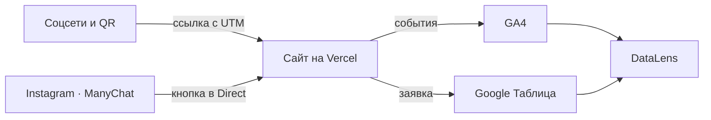

# Коворкинг ТОЧКА СБОРКИ — сайт и сквозная аналитика заявок

Курсовая работа по дисциплине ОП.03 «Информационные технологии», ТЗ № 17/2026.

Исполнитель: Кожемякин Эрик, группа 9/2-РПО-25/1.

Сайт кампании «Точка сборки» с предложением «Тест-день бесплатно, первый месяц −15 %», калькулятором тарифов и расписанием мероприятий: каждый посетитель приходит
с меткой источника, каждая заявка попадает в Google Таблицу, а руководитель
видит на дашборде, какой канал приводит клиентов, лучший тариф, день недели.



## Ссылки

| Что | Ссылка |
|---|---|
| Сайт | https://kovorking-tochka-sborki.vercel.app/ |
| Таблица заявок | https://docs.google.com/spreadsheets/d/1bHbqj_HgYABVbJQPpmXOO1ePUEIB8BmEE_ral0QoLDg/view?usp=sharing |
| Дашборд DataLens | ___ |
| Instagram и Reel с автоответом | ___ |
| ВКонтакте · Telegram · YouTube | ___ · ___ · ___ |
| Описание работы | [docs/opisanie.md](docs/opisanie.md) |
| Презентация к защите | - |

Ресурс GA4: `G-3W3GTP8FSB`. Доступ Viewer к ресурсу GA4 выдан: ___ (e-mail Заказчика).

## Что сделано

| Часть | Результат |
|---|---|
| Сайт | 9 страниц, статический HTML, Vercel, Lighthouse: + / + / ___ |

<!--
| GA4 | ___ событий, ___ пользовательских параметров, ключевые: `generate_lead`, ___ |
| UTM | ___ ссылок в реестре, публикации в ___ соцсетях, QR на афише |
| Заявки | форма → Apps Script → лист `leads`, проверка полей и повторов |
| Instagram | ManyChat, две ветки: `___` и `___` |
| Отчёты | Reports, Explore, воронка, путь, дашборд DataLens из трёх вкладок |

## Технологии

HTML, CSS, JavaScript · Google Analytics 4 · Google Таблицы и Apps Script ·
ManyChat · Yandex DataLens · GitHub и Vercel. Сайт создан с помощью ___
(запросы — в [docs/prompts.md](docs/prompts.md)).

## Структура

```text
index.html …         страницы сайта
js/analytics.js      все события GA4
apps-script/Code.gs  приёмник заявок
docs/                описание, реестр UTM, события, записка, схема
screens/             кадры-доказательства по разделам ТЗ
presentation/        презентация к защите
```

## Итог

Не получилось: ___
Нейросеть использовалась для: ___

-->
