# Описание работы · ТЗ № 17 · «Коворкинг «Точка сборки»»

**Исполнитель:** Кожемякин Эрик, группа 9/2-РПО-25/1.

**Сайт:** https://kovorking-tochka-sborki.vercel.app/

**Период проверок:** ___ — ___

## 1. Задача заказчика

Компания «ТОЧКА СБОРКИ» получает заявки из Instagram, Telegram и по телефону, но не знает, какой канал приводит
клиентов. Из 100 человек, которые пришли на тест-день,тариф покупают 31. Компания не знает, от чего это зависит: от канала,тарифа или дня
недели...

Задача — сайт, на котором видно источник каждого посетителя, и одна таблица со всеми заявками.

## 2. Схема работы

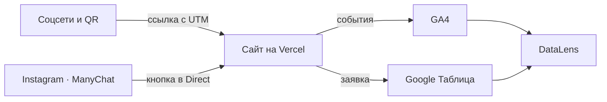

Посетитель приходит из соцсетей или по QR-коду по ссылке с UTM-метками.
Сайт отправляет события в GA4, а заявку — в Google Таблицу через Apps Script.
Данные GA4 и таблицы собираются на дашборде DataLens.

## 3. Сайт

Сайт из 9 страниц создан с помощью Claude Ai и доработан вручную.
Опубликован на Vercel, обновляется после каждого push.

* вид с ПК
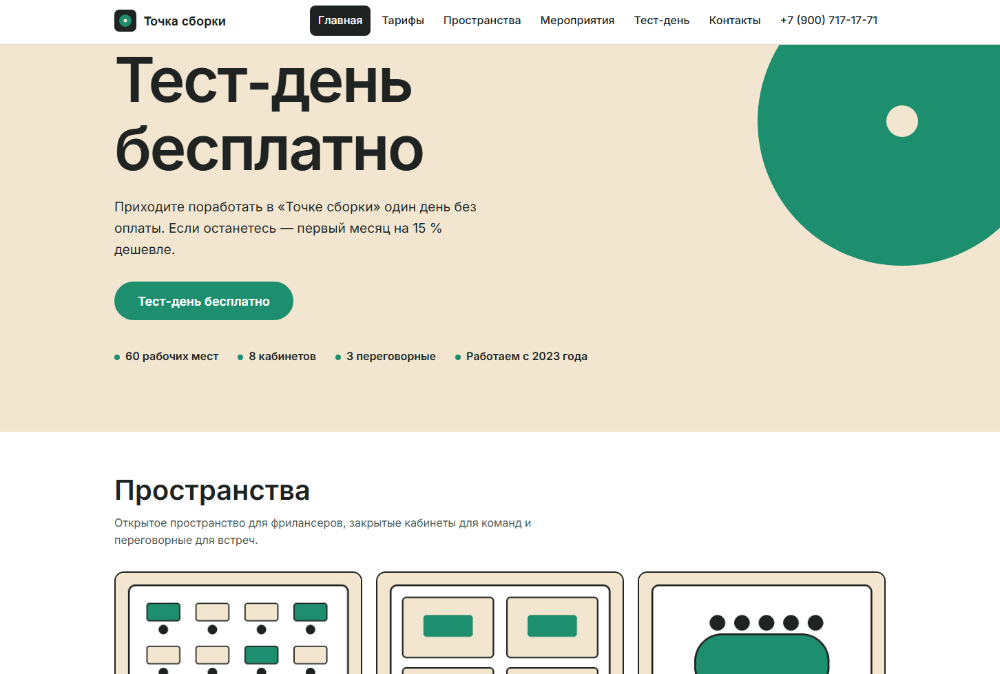

* вид со смартфона
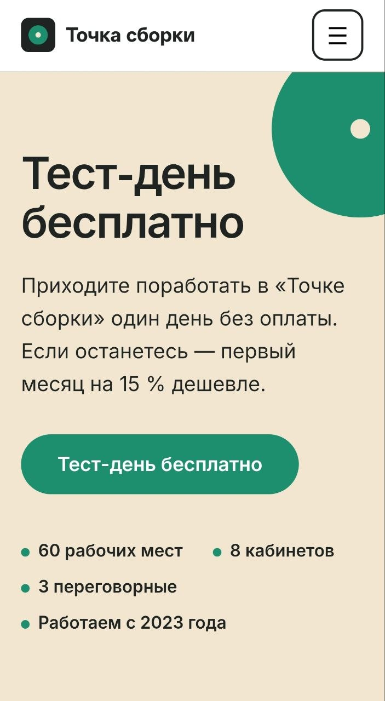

* Отчет lighthouse-mobile
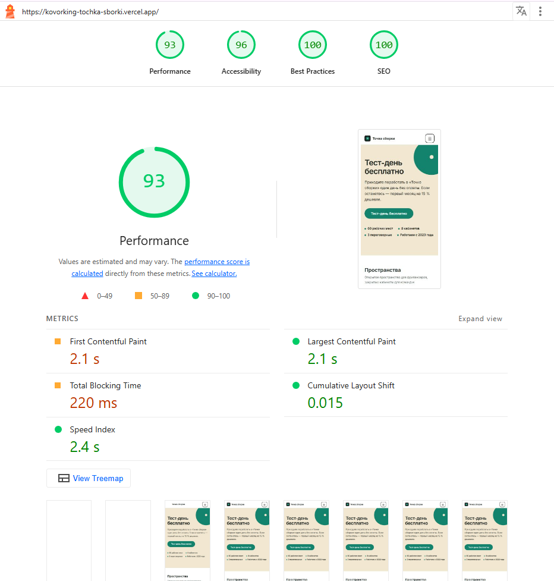

## 4. Аналитика GA4

Настроено 18 событий, из них своих — 12. Ключевые события: 3.
Каждое событие проверено в DebugView.

* Свои события (кроме generate_lead и form_error)

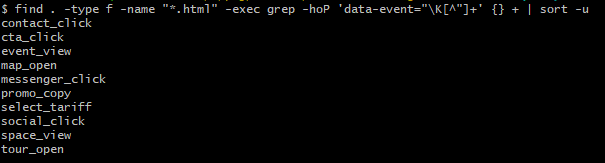

* Ключевые события

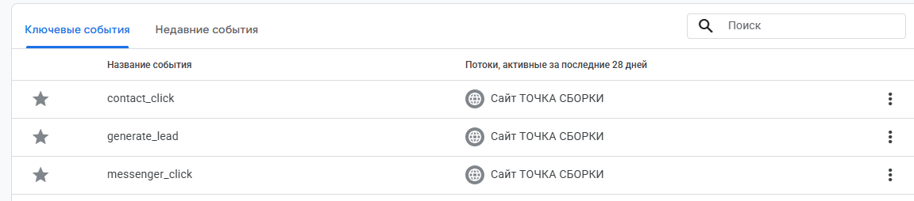

* События в DebugView

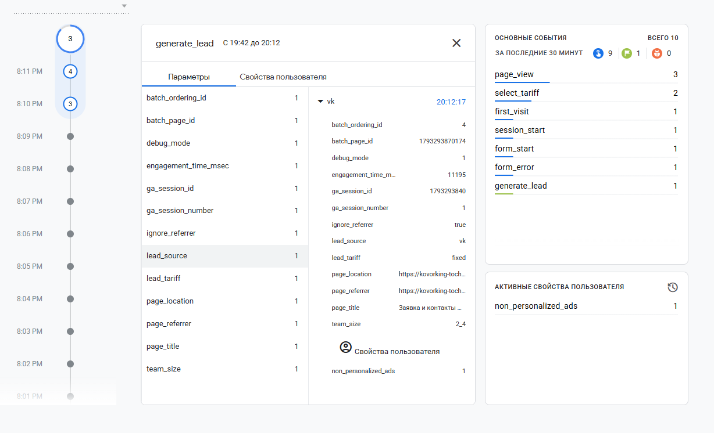

* Пользовательские параметры

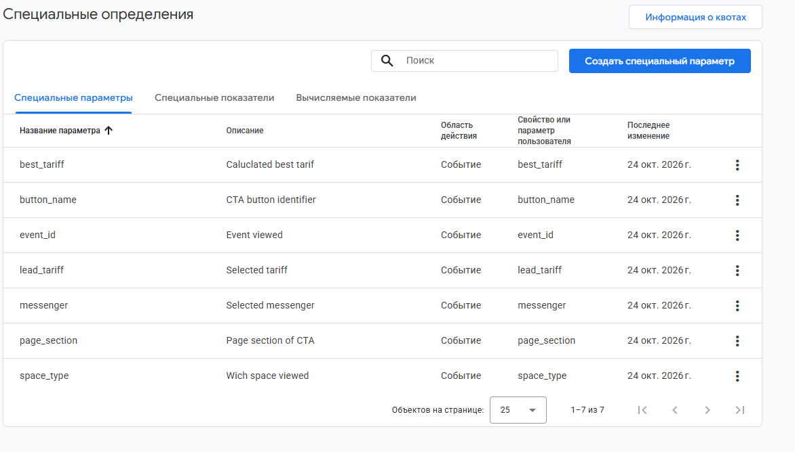

## 5. UTM-ссылки и соцсети

В реестре 12 ссылок, опубликованы в Instagram, ВКонтакте, Telegram,
YouTube, у двух партнёров и на афише с QR-кодом.

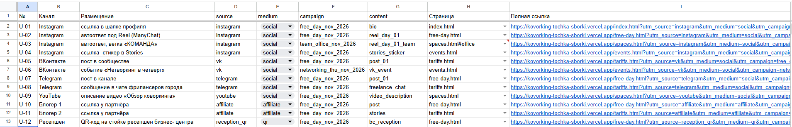
[utm.csv](utm.csv)

<!--

-->

## 6. Заявки

Форма отправляет заявку в Apps Script, тот проверяет поля и записывает
строку в лист `leads` вместе с метками. Повторная отправка не создаёт дубль.

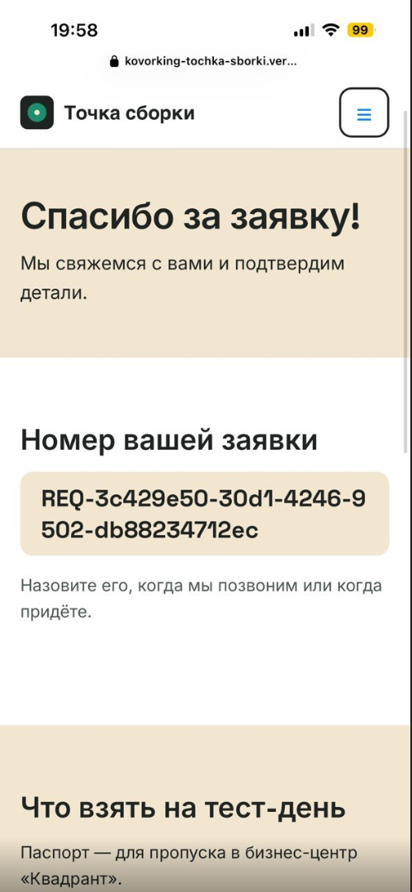

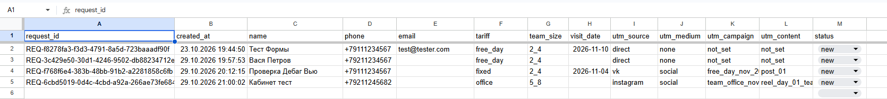

По таблице видно что в заявке со скриншота отсутвует utm метка. Это произошло потому что ни инстаграм ни сайт недоступны напрямую, а многие vpn обрезают utm метки и рекламу.
Расширения для блокировки рекламы вообще убивают всю аналитику.

## 7. Автоответы в Instagram

Комментарий «день» под Reel запускает ответ в комментариях и сообщение
в Direct с кнопкой на сайт. Вторая ветка — слово «команда».

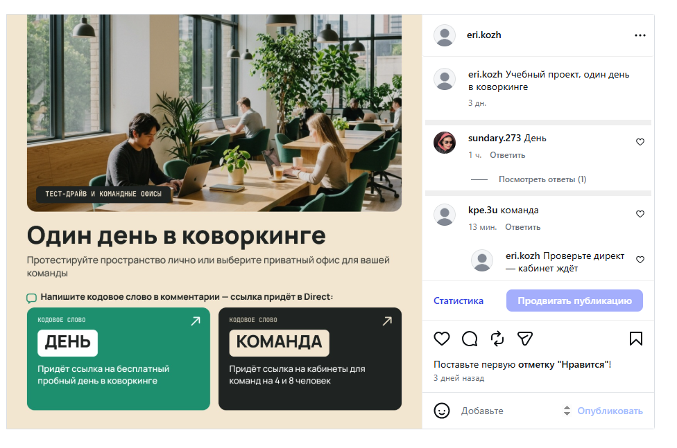
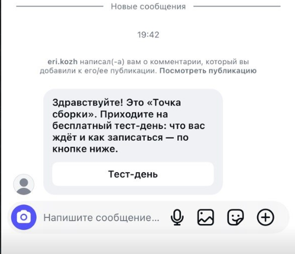

<!--

## 8. Отчёты и дашборд

Воронка показала наибольшую потерю между ___ и ___ (___ %).
Больше всего заявок принёс канал ___.

## 9. Что получил бизнес

| Было | Стало |
|---|---|
| заявки в личных сообщениях трёх аккаунтов | все заявки в одной таблице со статусом |
| источник клиента неизвестен | у каждой заявки есть source, medium, campaign |
| бюджет делится «по ощущениям» | на дашборде видно заявки по каждому каналу |
| ответы на комментарии вручную | ManyChat отвечает сразу и ведёт на сайт |

Рекомендация заказчику: ___ (по данным из раздела 8).

## 10. Итог

Не получилось: ___
ИИ использовался для: ___

